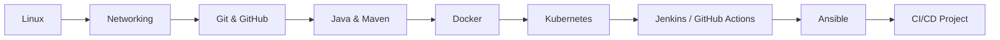

<div align="center">

# 🚀 DevOps Notes

**My personal DevOps learning journal: notes, hands-on practice, and projects.**


[Overview](#-overview) •
[Structure](#-repository-structure) •
[Roadmap](#-learning-roadmap) •
[Tech Stack](#-tech-stack) •
[Getting Started](#-getting-started) •
[Contributing](#-contributing)

</div>

---

## 📖 Overview

This repository documents my journey of learning **DevOps** step by step, from Linux and Git basics to containers, orchestration, CI/CD pipelines, and automation. Each folder focuses on one topic and contains notes, examples, and practice files.

> 🌱 This is a living repo. New topics and updates are added regularly.

---

## 🗂 Repository Structure

### 1️⃣ Foundations

| Folder | What's inside |
| --- | --- |
| [Devops Roadmap](./Devops%20Roadmap) | My DevOps notes and the roadmap I'm following |
| [Linux](./Linux) | Linux commands and shell scripting |
| [Virtualization network](./Virtualization%20network) | Virtualization and networking concepts |

### 2️⃣ Version Control

| Folder | What's inside |
| --- | --- |
| [git & github](./git%20%26%20github) | Git fundamentals, branching, and GitHub workflows |

### 3️⃣ Build Tools

| Folder | What's inside |
| --- | --- |
| [Java](./Java) | Java basics and Maven `pom.xml` summary |

### 4️⃣ Containers & Orchestration

| Folder | What's inside |
| --- | --- |
| [Docker](./Docker) | Images, containers, and examples (including detached mode) |
| [Kubernetes](./Kubernetes) | Orchestration concepts and manifests |

### 5️⃣ CI/CD & Automation

| Folder | What's inside |
| --- | --- |
| [Jenkins](./Jenkins) | Jenkins setup and pipelines |
| [Git Action](./Git%20Action) | Workflows with GitHub Actions |
| [Ansible](./Ansible) | Configuration management and a CI/CD pipeline |

### 6️⃣ Projects

| Folder | What's inside |
| --- | --- |
| [CI,CD project](./CI%2CCD%20project) | Complete end-to-end CI/CD project using Docker |

### 🖼 Supporting Files

| Folder | What's inside |
| --- | --- |
| [assets](./assets) | Images and diagrams used in the notes |

---

## 🧭 Learning Roadmap



### Progress Tracker

- [x] DevOps Roadmap
- [x] Linux & Shell Scripting
- [x] Virtualization & Networking
- [x] Git & GitHub
- [x] Java / Maven
- [x] Docker
- [x] Kubernetes
- [x] Jenkins
- [x] GitHub Actions
- [x] Ansible
- [x] CI/CD Project
- [x] AWS
- [ ] Terraform *(coming soon)*
- [ ] Monitoring (Prometheus & Grafana) *(coming soon)*


---

## 🛠 Tech Stack

| Category | Tools |
| --- | --- |
| **OS & Scripting** |   |
| **Version Control** |   |
| **Build** |   |
| **Containers** |   |
| **CI/CD** |   |
| **Automation** |  |

---

## ▶️ Getting Started

```bash
# Clone the repository
git clone https://github.com/nai1551/Devops_Notes.git

# Move into the project
cd Devops_Notes

# Browse a topic, for example Docker
cd Docker
```

Each folder is self-contained, so you can start with any topic you like.

---

## 🤝 Contributing

Suggestions and corrections are welcome.

1. Fork the repo
2. Create a branch: `git checkout -b improve-notes`
3. Commit: `git commit -m "Improve notes"`
4. Push: `git push origin improve-notes`
5. Open a Pull Request

---

## 👤 Author

**nai1551** · [GitHub Profile](https://github.com/nai1551)

<div align="center">

⭐ If these notes helped you, give the repo a star!

</div>
